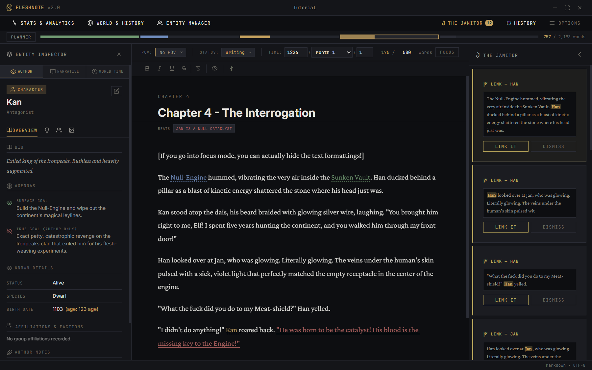
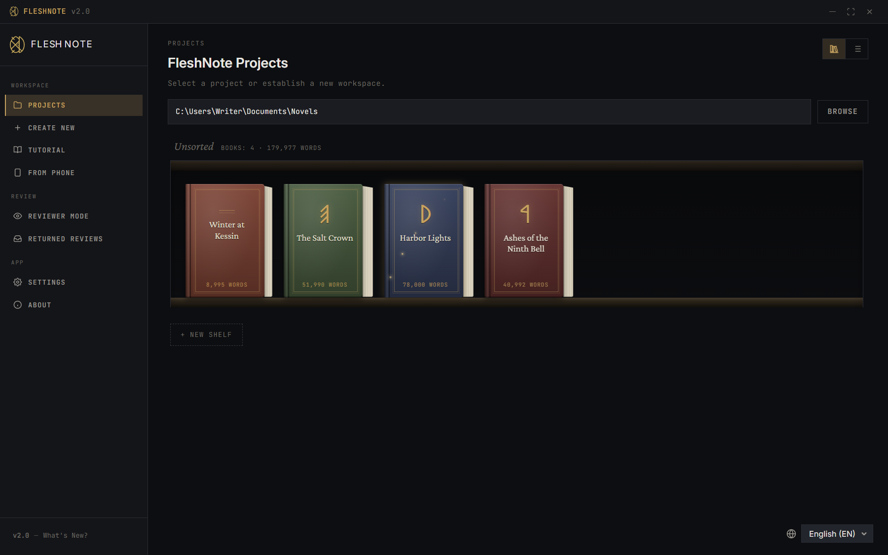
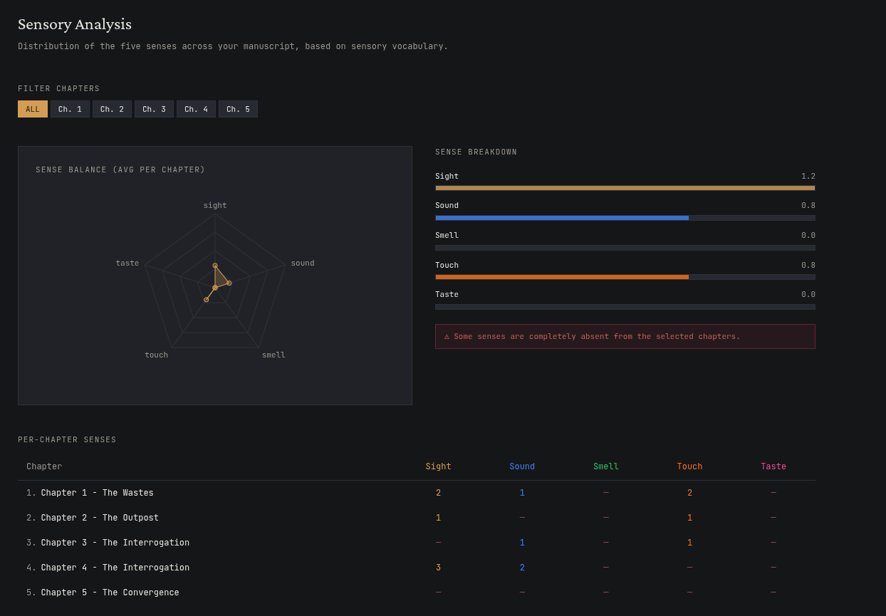
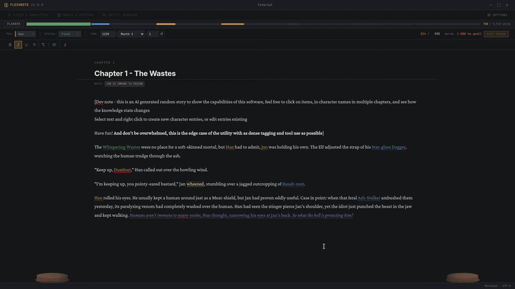
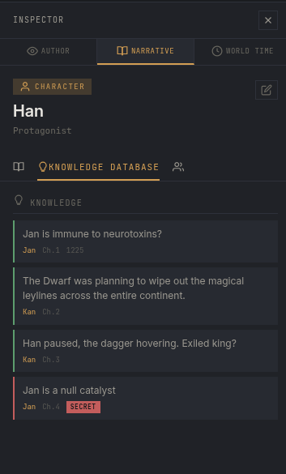
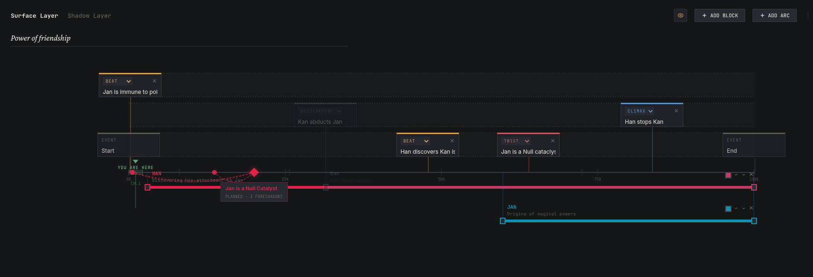
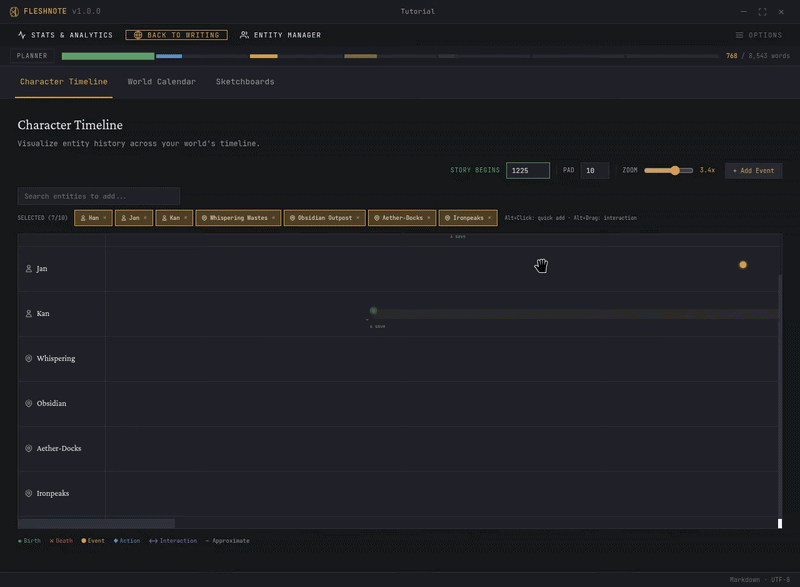
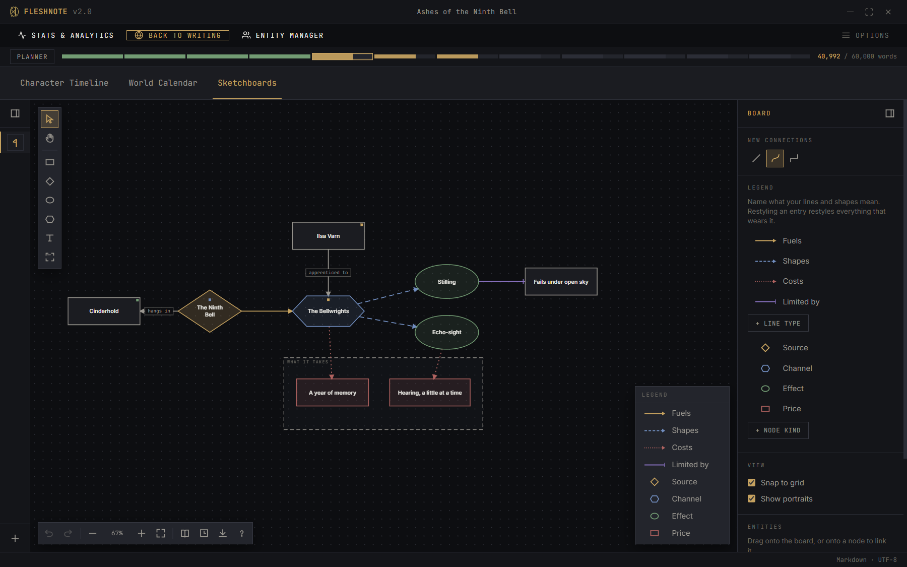
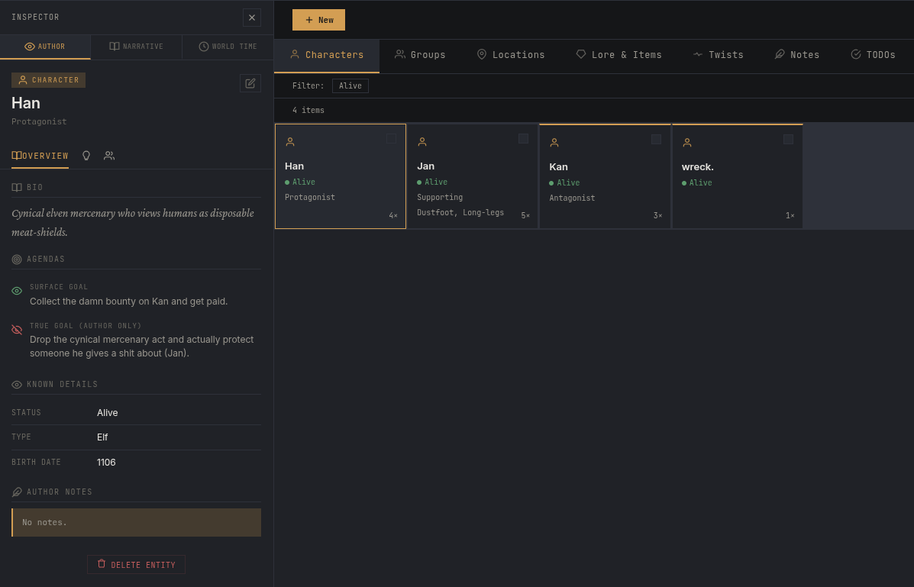
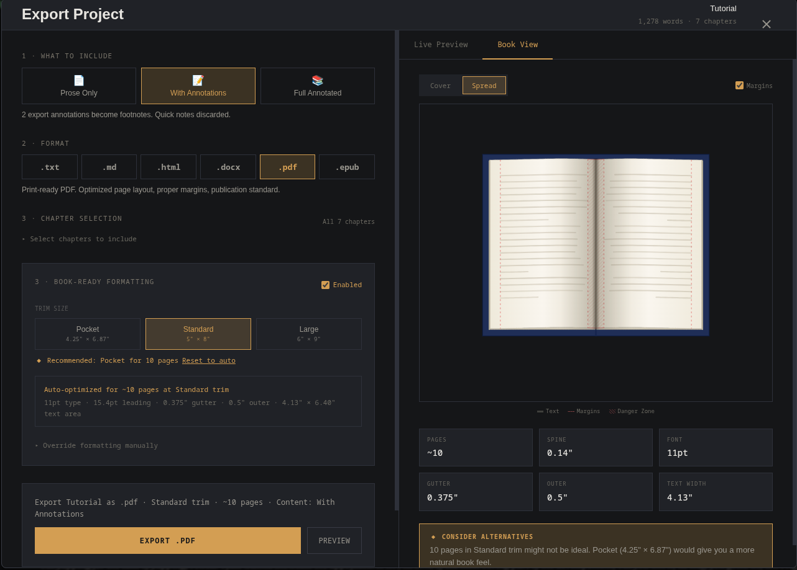

# FleshNote (v2.0)

> [!NOTE]
> 2.0 changes the project format. FleshNote upgrades projects made with 1.x and keeps a backup of the old database, but copy your project folders somewhere safe before you open them anyway. Feedback is very welcome: if something breaks or feels off, please open an issue.

A no-bullshit writing tool for novelists and world builders who actually want to finish their draft this century. Your projects stay on your computer. Built with Electron, React and FastAPI.

[](https://opensource.org/licenses/MPL-2.0)



## What's new in 2.0

- **Sketchboards, rebuilt.** Work out magic systems, tech trees, politics or trade on a canvas, with a legend, templates and a timeline. Relationships and Factions boards draw themselves from your notes.
- **Factions.** Group characters into factions and guilds, with roles, join and leave dates, and a history of their own.
- **History.** Chapters keep snapshots of earlier writing sessions. Compare them and roll back.
- **Story Architect.** A five-step planner for a new book: premise, cast, story structure, chapter scaffolding, and a brainstorm generator (no AI involved).
- **Story Pulse.** An intensity curve per chapter in the Plot Planner, so you can see where the book is tense and where it sags.
- **A smarter Janitor.** Choose how picky it is. Better show-don't-tell detection, a balance of the senses, and more rules for English, Hungarian and Polish.
- **Pentimento.** FleshNote can record how you write, so you can replay a chapter being written and show that a person wrote it. If you opt in, the records are sealed with a trusted timestamp.
- **Review copies.** Send a beta reader a stripped-down `.flreview` file, optionally set to expire. They comment in FleshNote's reviewer mode, and their notes come back into your manuscript.
- **Export, rebuilt.** Print-ready PDFs (printed book or manuscript submission), DOCX and EPUB, with a preview of the real pages. There's also an early cover editor.
- **Obsidian export.** Turn a project into an Obsidian vault (notes, links, and sketchboards as `.canvas` files) or into plain text.
- **Manuscript import.** Bring in a `.docx`, `.txt` or `.md` file. FleshNote suggests where the chapters split and finds the names in it.
- **A bookshelf** for your projects, with colours, runes and shelves of your own.
- **Wi-Fi sync** with the upcoming phone app. It's encrypted and goes straight between your devices, no cloud.
- **Run it in a browser** on your own server (see [VPS_DEPLOY.md](VPS_DEPLOY.md)).
- **A smaller installer**, and the app no longer fights other programs over port 8000.



## Why FleshNote?

FleshNote was built by writers, for writers. I created this app mainly for myself to help me write my novel, but I decided to make it open source so that other writers can benefit from it as well.

### The Janitor

Write now, edit later. The Janitor reads your chapters in the background and points out things to fix, without interrupting you. It runs on your computer (spaCy and NLTK, no AI service):

- **Senses:** shows which senses a scene uses, so you notice when it has no smell, sound or touch at all ("white room syndrome").
- **Show, don't tell:** flags weak adverbs, passive voice and telling.
- **Readability and pacing:** grades how hard a chapter is to read, and warns you when three sentences in a row start with the same word.



### Sprint modes

For when you need a push to get the draft done. Six focus modes, some rewarding and some punishing:

- **Hemingway:** Backspace and Delete don't work. Forward only.
- **Zen:** a tree grows as you write, and blooms when you hit your goal.
- **Kamikaze:** stop typing for a minute and your words start disappearing.
- **Fog:** text away from where you're typing fades out, so you can't scroll back and fiddle.
- **Momentum** and **Combo:** type faster to fill a bar, or build a combo that breaks if you delete too much.



### Who knows what

Track what each character knows, and from which chapter. Keep a character's true goal hidden in the inspector while they lie to the reader, and follow the lie across chapters.



### Plot Planner

A zoomable timeline for beats, arcs and foreshadowing, tied to the actual chapters.



### World history

What happened before chapter one. Put relationships and backstory events for your characters and items on a timeline.



### Sketchboards

Boards for working out how your world works: shapes, labelled connections, a legend that says what they mean, and a slider that shows the board as it stands at any chapter. Link a node to a character, place or faction and it keeps their current name. The Relationships and Factions boards take their lines from the relationship tracker and the faction rosters, so they stay up to date.



### Characters, places, lore and twists

All in one tabbed manager, with bulk editing. Type `@` in the editor to link a name as you write.



### Export

PDF (printed book or manuscript submission), DOCX and EPUB, with a preview of the real pages. The cover editor (still early) lays out the front, spine and back at your book's size, with the spine as wide as your page count makes it.



### Other features

- **Time overrides:** mark flashbacks and time skips inside a chapter, so ages and relationships stay correct.
- **Weather** per location. Smaller places inherit it from the region they're in.
- **Daily writing prompts** and streaks when you open a project.
- **Renaming:** rename a character or place everywhere in the manuscript at once, links included.
- **Custom calendars** with your own months, seasons and eras, used for ages and history.
- **Image galleries** for every character, place and lore entry, each with a cropped icon.
- **Name generators:** pick from real-name lists and presets, or answer a few questions about a place and get name ideas.
- **Interface languages:** English, Hungarian and Polish. The Arabic translation is being updated.

---

# Getting started

> **Windows users:** I'm a solo indie dev and I don't plan on buying an expensive Windows code signing certificate. When you install the app, Windows SmartScreen will show a scary blue pop-up about an "unrecognized app". Click **More info** → **Run anyway** to install it.

### Prerequisites

- [Node.js](https://nodejs.org/) 22 or newer
- [Python 3.13](https://www.python.org/). Not 3.14 yet: some of the language packages don't install on it. If your Linux distribution ships 3.14, get 3.13 through pyenv, uv or your package manager.

### Installation

1. Clone the repository and go into the `fleshnote-ide` folder:
   ```bash
   cd fleshnote-ide
   ```
2. Install the frontend dependencies:
   ```bash
   npm install
   ```
3. Set up the Python backend:
   ```bash
   cd backend
   python3.13 -m venv .venv    # on Windows: py -3.13 -m venv .venv
   source .venv/bin/activate  # on Windows: .venv\Scripts\activate
   pip install -r requirements.txt
   cd ..
   ```

### Development

```bash
npm run dev
```

## Building the installers

The build scripts do everything: they set up the Python environment, freeze the backend with PyInstaller, build the app and package it. The installers end up in `fleshnote-ide/dist/`.

**Windows:**
```bash
.build.bat
```

**Linux / macOS:**
```bash
chmod +x build.sh
./build.sh linux  # or ./build.sh mac
```

On Linux this makes an AppImage, a snap, a `.deb` and a Flatpak. The Flatpak needs `flatpak` and `flatpak-builder`, plus the Flathub remote added for your user:

```bash
flatpak remote-add --user --if-not-exists flathub https://flathub.org/repo/flathub.flatpakrepo
```

Without them, the script stops at the Flatpak step. The backend and app are built by then, so you can package the rest with `npx electron-builder --linux AppImage deb`.

### Building by hand

Freeze the backend first. The build uses `requirements_build.txt` instead of `requirements.txt`, and `huspacy` has to be installed on its own, because its `packaging<22.0` requirement clashes with PyInstaller 6:

```bash
cd backend
pip install -r requirements_build.txt
pip install --no-deps huspacy==0.12.1
python build_backend.py
cd ..
```

Then package the app with one of `npm run build:win`, `build:mac`, `build:linux` or `build:flatpak`.

## Running it in a browser on your own server

FleshNote can also run in a browser, served from a server you own, behind a password and HTTPS (through Caddy). It's meant for people comfortable with a Linux shell. The guide is **[VPS_DEPLOY.md](VPS_DEPLOY.md)**.

### For developers: the browser build

`npm run build:web` builds the browser version into `fleshnote-ide/out/web`. It isn't part of the desktop app or `npm run dev`.

- `src/web/` stands in for Electron. Most IPC handlers in `src/main/index.ts` only pass their arguments on to the backend, and the build reuses them as they are. A handler that uses Electron itself, the file system or the main process's own state needs a browser version in `src/web/handlers.ts`; otherwise `npm run build:web` fails and names it.
- `backend/web_main.py --config <file>` serves the pages behind a login (`backend/web_standalone.py`). Its extra routes (uploads, downloads, files) are only safe behind that login, so never expose `web_main.py` without it.
- `deploy/selfhost/` has the systemd unit, config and Caddyfile the guide uses. `labs/` and `scripts/deploy-labs.mjs` deploy to my own test server and won't be useful to you.

## Recommended setup

[VS Code](https://code.visualstudio.com/) with [ESLint](https://marketplace.visualstudio.com/items?itemName=dbaeumer.vscode-eslint) and [Prettier](https://marketplace.visualstudio.com/items?itemName=esbenp.prettier-vscode).

## The old 1.2 version

FleshNote changed a lot in 2.0. If you prefer the old, simpler app (the one from before the new project format), version 1.2.0 is still on the [`legacy`](https://github.com/ArtFacility/FleshNote/tree/legacy) branch. It won't get new features, but bug fixes are welcome there, and I may fix bugs in it myself too.

## License

FleshNote is licensed under the **Mozilla Public License 2.0**. See [LICENSE](LICENSE) for the full text.

---
Made by [Artfacility](https://www.artfacility.xyz)
